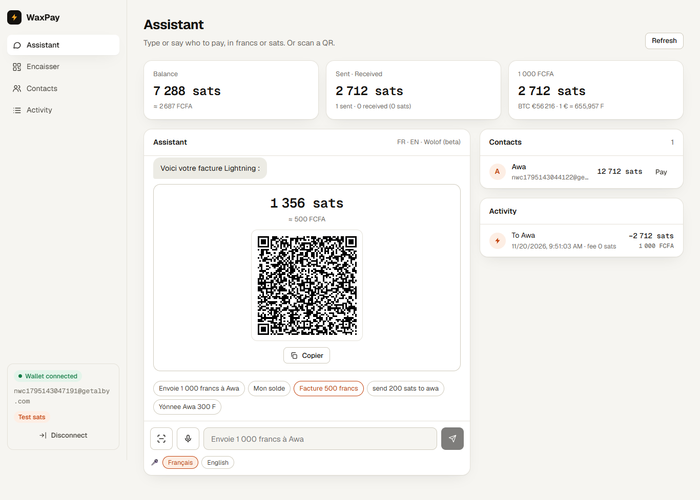
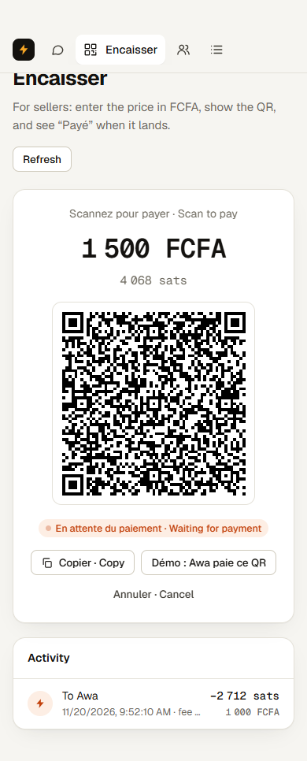
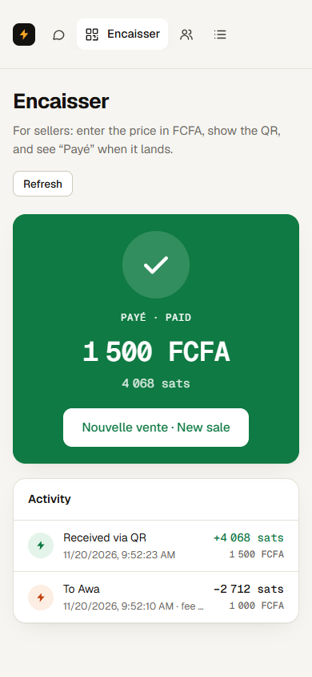

<p align="center"></p>

# WaxPay

Lightning payments for how people in Dakar already handle money. Prices are in CFA francs, people pay each other by name, and sellers need to know a payment arrived without checking a phone.

*Wax* means "to speak" in Wolof.

**Live demo:** _add Vercel URL_ · **Video:** _add link_

| Pay by sentence | Seller till (Encaisser) | Paid |
| --- | --- | --- |
|  |  |  |

## The problem

Bitcoin wallets ask people to think in sats and handle invoices. In Senegal, people think in francs, a seller needs to know straight away that a sale is paid, and money goes to people, not to strings of characters.

## What WaxPay does

- **Pay by sentence.** Type or say "Envoie 1 000 francs à Awa", "send 500 sats to fatou@getalby.com" or "Yónnee Awa 300 F". WaxPay converts francs to sats, shows a confirmation card, and pays only after you tap Confirm.
- **AI for free-form sentences.** Short commands go through an instant rule parser. Longer or looser sentences, such as "Awa m'a vendu 3 poissons à 500 F chacun, paie-la" or Wolof amounts like "ñaar junni" (2,000) and "téeméer dërëm" (500 FCFA), go to an LLM (DeepSeek via Vikey). The model only proposes an intent, and the app still checks the recipient, the amount cap and your confirmation.
- **Encaisser (seller mode).** Key in the price in FCFA and WaxPay shows a Lightning QR. When the payment settles, the screen turns green with "Payé", so a market seller doesn't need to check anything.
- **Scan to pay.** Scan any Lightning invoice QR with the camera, or paste one. WaxPay decodes it, shows the amount in FCFA, and asks you to confirm.
- **Nostr contacts.** Import everyone you follow on Nostr who has a Lightning address. You can then pay them by first name, or pay any `npub` directly.
- **Connect any wallet.** Bitcoin Connect supports Alby, Alby Hub, Coinos, Primal and any Nostr Wallet Connect wallet. You can also start with two free test wallets holding fake sats.
- **Receipts.** Every payment shows the time it took, the fee and the Lightning preimage as proof of payment. Received payments appear in Activity.

## Evidence

All runs used test wallets from Alby's `faucet.nwc.dev` (fake sats) on 20 Nov 2026.

| Check | Result |
| --- | --- |
| Node script `npm run test:e2e`: wallet A pays B's Lightning address | 2,500 sats paid in **495 ms**, fee 0, balances 10,000/1,000 → 7,500/3,500 |
| Browser smoke test `npm run test:smoke` (headless Edge, 1366 px and 390 px) | "Envoie 1 000 francs à Awa" paid in 1.7–9.2 s; Encaisser QR for 1,500 FCFA turned to "Payé" 1.9–10.5 s after payment; 79–114 contacts imported from a public Nostr account; wallet and history survive a reload; no console errors; no horizontal scroll on mobile |
| Unit tests `npm test` | 19 tests: parser (French, English, Wolof word order, "1 000" / "2.500" / "2k"), FCFA conversion, Nostr contact names, AI output validation (invented recipients and bad amounts rejected) |
| AI evaluation `npx vite-node scripts/ai-eval.ts` | 10 real sentences (French prose, number words, Wolof amounts and dërëm, unknown contact, missing amount, prompt injection): 10/10 handled as expected |

Payment times depend on the public test relay. During the same day, the same flow took between about 2 and 10 seconds.

## How it works

```
"Envoie 1 000 francs à Awa"  (typed, spoken or a scanned QR)
   │
   ├─ parser            src/lib/parse.ts    FR / EN / Wolof keywords, FCFA or sats, 200-char cap
   ├─ FCFA → sats       src/lib/rates.ts    1 EUR = 655.957 XOF (BCEAO peg) × live BTC/EUR (mempool.space)
   ├─ recipient         contact → Lightning address; npub → Nostr profile (kind 0) → lud16
   ├─ confirm card      nothing moves without a tap; 50,000 sat cap; invoice amount is checked
   ├─ LNURL-pay         fetch an invoice from the Lightning address (lightning-tools)
   ├─ pay               WebLN / NWC pay_invoice via Bitcoin Connect, sent over Nostr relays (NIP-47)
   └─ receipt           preimage, fee, time

Encaisser: make_invoice → QR → poll lookup_invoice until settled → "Payé"
```

- **Bitcoin / Lightning:** every payment is a real Lightning payment with a preimage. Recipients are reached through Lightning addresses (LNURL-pay), so users never handle raw invoices unless they scan one.
- **AI:** `/api/parse` sends the sentence to DeepSeek with a strict JSON schema. If the provider stalls, a second request is fired after 3.5 s and the first answer wins.
- **Nostr:** wallet commands are NIP-47 events sent over Nostr relays. Contacts come from your Nostr follow list (kind 3) and profiles (kind 0), and NIP-05 names resolve to Nostr keys.
- **No backend:** the app is static. Contacts and history stay in the browser.

## Run it

```bash
npm install
npm run dev          # http://localhost:5173
npm test             # unit tests
npm run test:e2e     # real Lightning payment between two faucet test wallets
npm run build && npx vite preview --port 4173 &
npm run test:smoke   # full browser flow in headless Edge
```

## Safety

- Nothing is paid without an explicit confirmation step.
- A single payment is capped at 50,000 sats.
- WaxPay checks that the invoice amount matches what you confirmed, and rejects expired invoices and invoices without an amount.
- A retry re-pays the same invoice. A Lightning invoice can only settle once, so a retry can't pay twice.
- WaxPay never sees your keys. With a real wallet, give the WaxPay connection a small spending budget, and revoke it in your wallet whenever you want.

## Limits and honest notes

- Wolof support is a handful of keywords (`yónnee`, `xaalis`) plus Wolof word order. A native speaker has not reviewed it, and the bot replies in French.
- Voice input uses the browser's speech recognition. It works in Chrome, Edge and Safari, and supports French and English only.
- The AI runs server-side (`api/parse.ts`). It only sees the message and your contacts' first names, never addresses or wallet data. Its output is validated: the recipient must be a saved contact or an address you typed, and the amount must be a positive whole number. If the AI is slow or down, short commands still work through the rule parser.
- The demo uses test wallets with fake sats. "Démo : Awa paie ce QR" in seller mode pays the QR from Awa's test wallet so the flow can be shown on one screen.
- This project was built during the hackathon with an AI coding assistant (Claude Code). The author set the direction, made the decisions and tested the app.

## Built with

React, Vite, TypeScript, a Vercel serverless function with DeepSeek (via Vikey) for the AI, Bitcoin Connect, `@getalby/sdk` (NWC), `@getalby/lightning-tools` (LNURL, BOLT11), `nostr-tools`, `qrcode`, `jsqr`, and the mempool.space price API.
